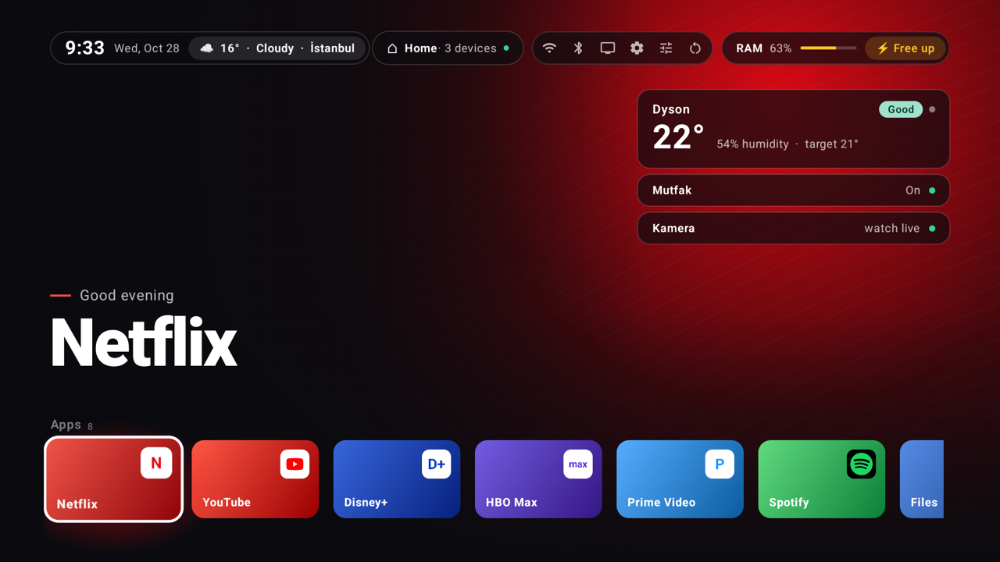
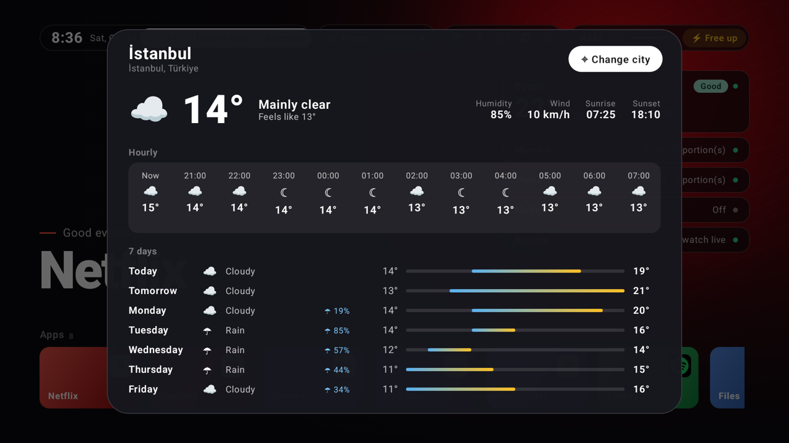
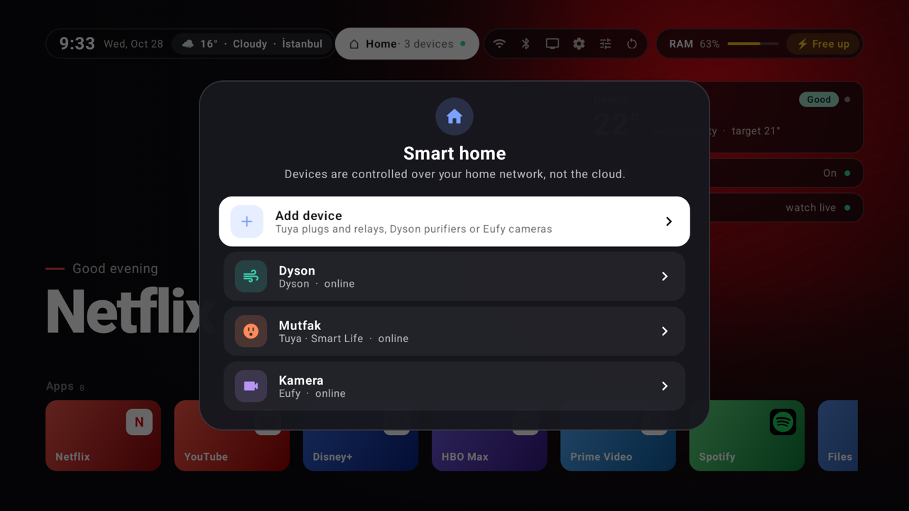
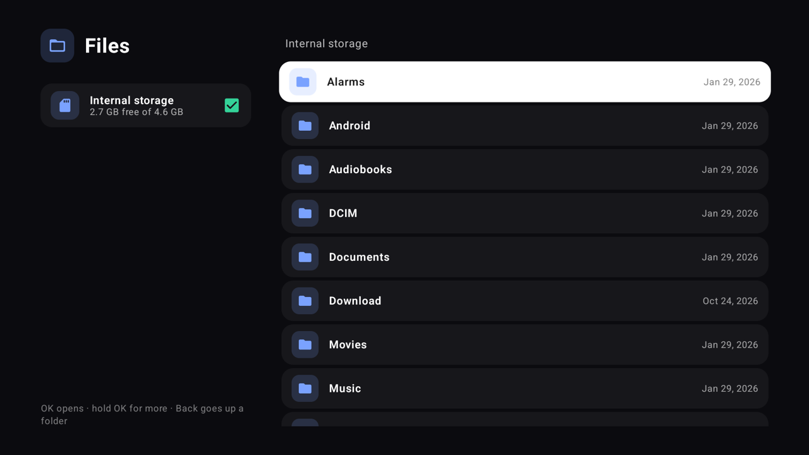
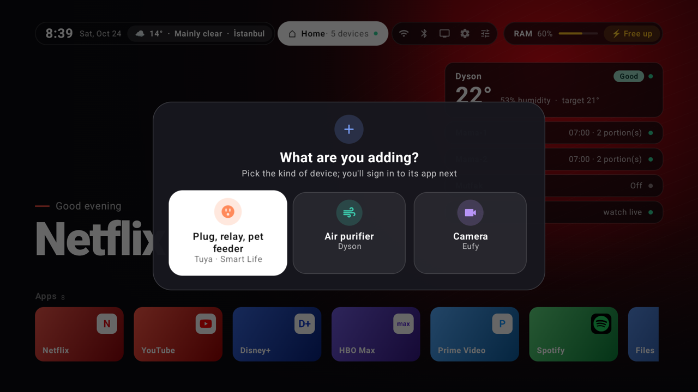
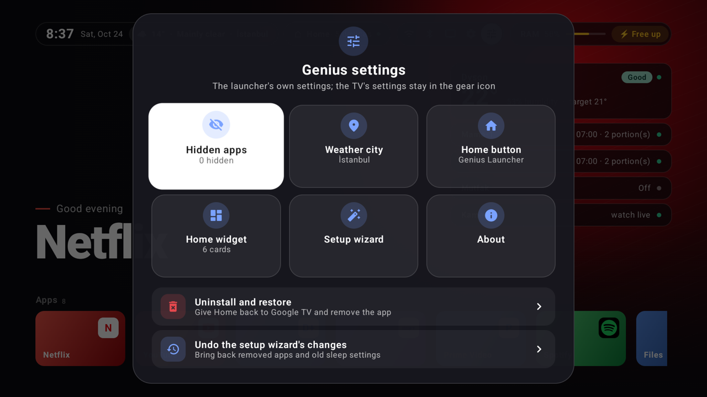
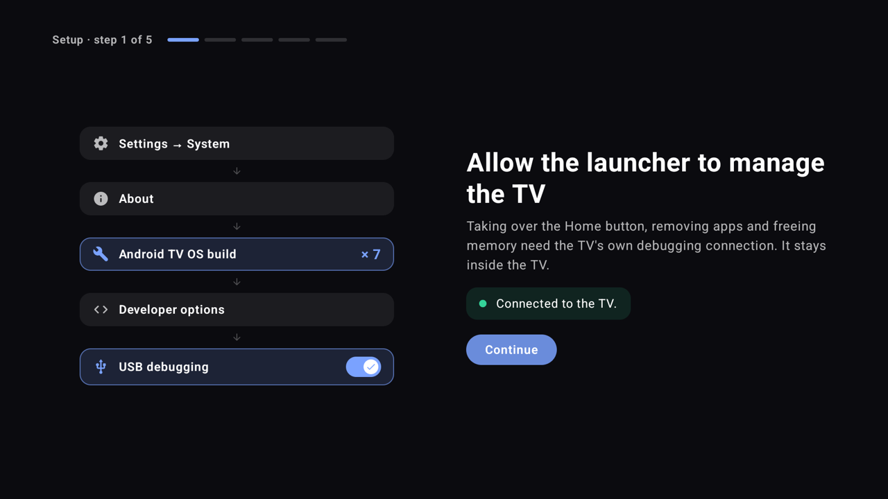

# Genius Launcher

[Türkçe](README.md) | **English**

A clean, ad-free home screen for Android TV and Google TV. It also controls the smart devices in your home over your home network, without going through the cloud.



> The first target device is the Xiaomi Mi Box S (2nd gen, Android 14). It should work on other Android TV devices too, but they haven't been tried.

## Features

- **Showcase**: The focused app's name is written in large letters; the background takes a color picked from the app's icon.
- **Apps**: Hold OK on the remote to move, hide or recolor a card. New apps get a card on their own; hidden ones come back from Genius settings.
- **Files**: Browse, rename and delete files on internal storage and USB sticks. Videos, music and pictures open inside the launcher (even when the TV has no player app). APKs are installed after you confirm. Files is a card like the apps, so you can hide it.
- **Weather**: Current weather next to the clock; press it for an hourly and 7-day forecast. Data comes from [Open-Meteo](https://open-meteo.com) and the city can be changed.
- **Smart home**: Tuya (plugs, relays, pet feeders), Dyson air purifiers and Eufy cameras appear as cards at the top right. Cards can be reordered and renamed; you choose how many are shown (3–6) and the rest go to an "Other" panel.
- **Camera**: Press an Eufy camera's card for a full-screen live view with sound (RTSP). Pan & Tilt cameras turn with the remote's arrow keys.
- **Setup wizard**: Full-screen illustrated steps for the TV's ADB permission, the Home button, removing bloatware and "stay awake". Everything can be undone.
- **Memory**: RAM use in the top bar; **Free up** closes apps running in the background.
- **Updates**: Since the app isn't on the Play Store, it finds new versions on GitHub by itself and shows a dot on the Genius settings icon. Pressing **Update** downloads the APK, checks it against GitHub's SHA-256 digest and installs it over the TV's ADB; settings and devices stay.
- **Screensaver**: As on Google TV, pressing Back twice on the home screen starts it.
- English and Turkish; follows the system language.







## Smart home

Devices are added from the **Home** chip in the top bar: **Home → Add device**.



- **Tuya · Smart Life**: Type the user code from the app and scan the QR code on the TV with the Smart Life app, then pick the devices you want from your account. The TV finds them on your home network and looks again if their addresses change. If a device is set up again, **Reconnect** in the panel renews its key.
- **Dyson**: With a MyDyson account (a code sent by email plus your password), or without an account from the Wi-Fi sticker on the device. The TV finds the purifier on your home network with mDNS.
- **Eufy camera**: First, in the Eufy app, open **Camera settings → General → Storage → NAS (RTSP)**, turn it on and set a username and password. Then type them on the TV; it finds the camera on your home network and asks for its IP address only if it can't. Turning the camera needs no account.

## Security

- Devices are controlled **over your home network**. Accounts are used only once, when you add devices.
- Tuya, Dyson and Eufy **account passwords and cloud tokens are never stored**; they're only used while signing in.
- Device keys (Tuya `local_key`, Dyson MQTT password, Eufy RTSP password) stay on the TV only, in the app's private storage.
- **The ADB connection stays inside the TV** (127.0.0.1). For things a normal app can't do on Android 14 (the Home button, removing apps, freeing memory, file access, installing APKs) the launcher connects to the TV's own ADB. The TV asks for permission the first time.
- Camera video doesn't go to the cloud; it comes over your home network with RTSP.
- This repo contains no device keys, account details or IP addresses. `secrets/`, `devices.json`, `*.secrets.json` and `local.properties` are in `.gitignore`.

## Requirements

- Android TV or Google TV, Android 8.0 or later
- **USB debugging** on the TV for the Home button, app cleanup, freeing memory and Files (the setup wizard shows how to turn it on)

## Installation

### Prebuilt release

1. Download the latest `genius-launcher-x.y.z.apk` from the [Releases](https://github.com/meteciftci/genius-launcher/releases) page.
2. Install it on the TV from a computer (USB debugging must be on):
   ```bash
   adb connect 192.168.1.50:5555
   adb install genius-launcher-x.y.z.apk
   ```
3. Open **Genius Launcher** from the apps list. The setup wizard appears on first launch.

### Building from source

You need JDK 17 and the Android SDK (platform 35, build-tools 35).

```bash
brew install openjdk@17
brew install --cask android-commandlinetools android-platform-tools
sdkmanager "platforms;android-35" "build-tools;35.0.0"
git clone https://github.com/meteciftci/genius-launcher.git
cd genius-launcher
```

Put the SDK path in `local.properties` (this file isn't committed):

```
sdk.dir=/opt/homebrew/share/android-commandlinetools
```

To add Tuya devices from the TV, also put the client ID for the QR sign-in in the same file. The public ID of Home Assistant's Tuya integration works; without it, the Tuya option in the panel doesn't work:

```
tuya.clientId=HA_3y9q4ak7g4ephrvke
tuya.schema=haauthorize
```

Put the TV's adb address in `tools/.tv` (not committed either):

```bash
echo 192.168.1.50:5555 > tools/.tv
```

Build a release and install it on the TV. The script compiles the app ahead of time on the device (avoiding stutter on the first launches) and opens it:

```bash
zsh tools/install.sh
```

Use `zsh tools/perf.sh` to measure smoothness. Helper scripts for Mi Box cleanup and sleep settings are in `tools/mibox/`.

#### Sample data

When the launcher receives a `demo` request, it shows sample cards (Netflix, Disney+, HBO Max, Prime Video; letters instead of the real logos) instead of the TV's apps, and Istanbul as the city. The README screenshots were taken this way. No settings are written; the sample data is gone once the launcher is closed.

```bash
adb shell am start -n dev.evim.tv/.MainActivity --ez demo true
adb shell cmd locale set-app-locales dev.evim.tv --locales en-US   # for English screenshots
```

## Usage

| Remote | Action |
| --- | --- |
| OK | Open the app, device or file |
| Hold OK | Menu: move, hide, pick a color, rename, delete |
| Back | Close the panel; in Files, go up a folder |
| Back twice on the home screen | Start the screensaver |
| Arrow keys on a camera | Turn a Pan & Tilt camera |
| OK on a camera | Sound on/off |
| OK / left-right on music | Pause / skip 10 seconds |
| Left-right on a picture | Previous/next picture in the folder |



### First-run setup wizard



A wizard appears the first time the launcher opens; every step can be skipped and it can be run again from Genius settings:

1. **The TV's own ADB**: Explains how to turn on USB debugging and brings up the TV's permission prompt.
2. **Home button**: Makes Genius Launcher the home screen (see below).
3. **Cleanup**: Lists known bloatware for the brand (Xiaomi Mi Box first); recommended ones are selected. Apps aren't deleted, they're removed for the TV's user. An app that saved the Wi-Fi network you're connected to can't be selected.
4. **Stay awake (optional)**: The box doesn't sleep when the TV turns off and stays on your home network.

The wizard records what it changed (with the old setting values). **Undo the setup wizard's changes** in Genius settings restores only those; **Uninstall** offers to restore them first too.

### Home screen (Home button)

Google TV ignores other launchers while its own home screen is enabled. So Google TV's setup wizard and then its home screen are turned off (not removed) and the Home button goes to Genius Launcher. If the app that saved the connected Wi-Fi network would be turned off, nothing is done. The setup wizard or Genius settings does this; for development, the same from a computer:

```bash
zsh tools/mibox/ana_ekran.sh genius   # Genius Launcher
zsh tools/mibox/ana_ekran.sh google   # back to Google TV
```

If the launcher crashes 3 times in 5 minutes, it turns Google TV's home screen back on by itself.

## Known limitations

- **Tuya**: Versions 3.3 and 3.4 of the local protocol are supported, 3.5 isn't yet. Full control only for tried types (plugs/relays, Xenon X8605 pet feeder); unknown devices get on/off or status only.
- **Dyson**: Tried with a heated purifier (527K); some values may be missing on other models.
- **Eufy**: Only cameras that offer RTSP. Turning was tried with the Indoor Cam Pan & Tilt (T8410). With RTSP on, Eufy lowers the video to 1080p.
- **Files**: Videos and music play in formats the device's hardware can decode. Installing the launcher's own APK from Files restarts the launcher.

## Credits

- The approach to replacing the home screen on Google TV was inspired by [Free My TV](https://github.com/simbasjungles/free-my-tv) (MIT).
- The Tuya QR sign-in is a Kotlin port of [tuya-device-sharing-sdk](https://github.com/tuya/tuya-device-sharing-sdk) (MIT), and the Dyson cloud sign-in of [libdyson-neon](https://github.com/libdyson-wg/libdyson-neon) (Apache-2.0).
- Eufy P2P local discovery and the turn command come from [eufy-security-client](https://github.com/bropat/eufy-security-client) (MIT).
- Libraries: [dadb](https://github.com/mobile-dev-inc/dadb), [ZXing](https://github.com/zxing/zxing), [Media3](https://github.com/androidx/media) (all Apache-2.0).

## License

[MIT](LICENSE)
