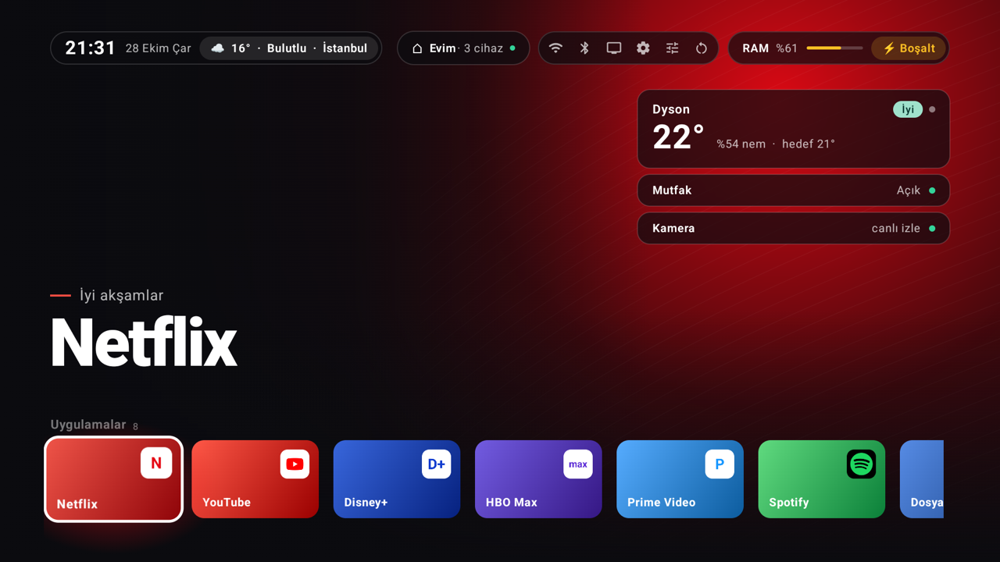
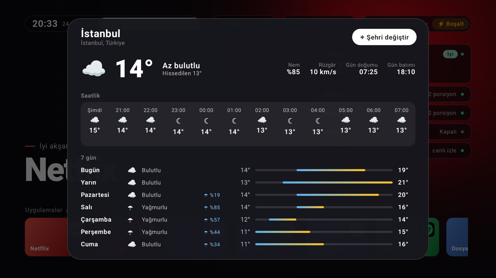
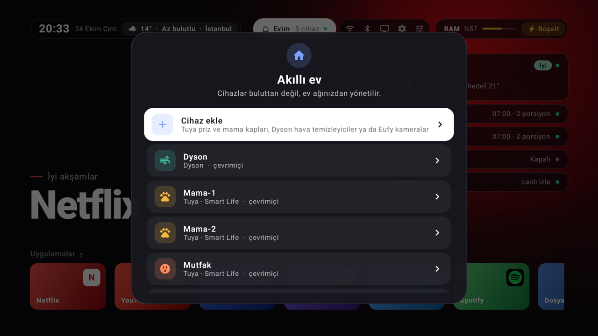
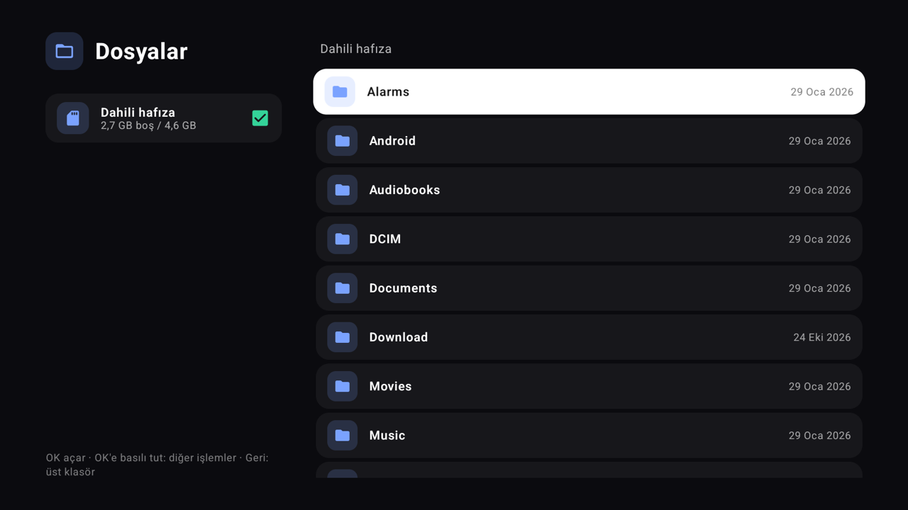
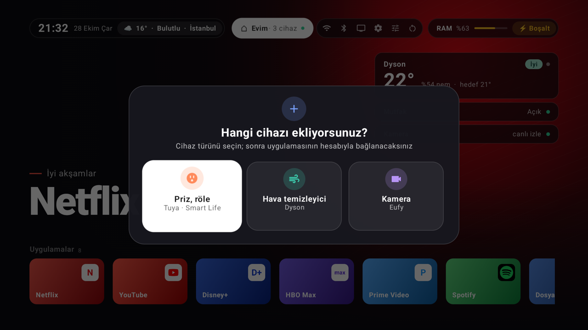
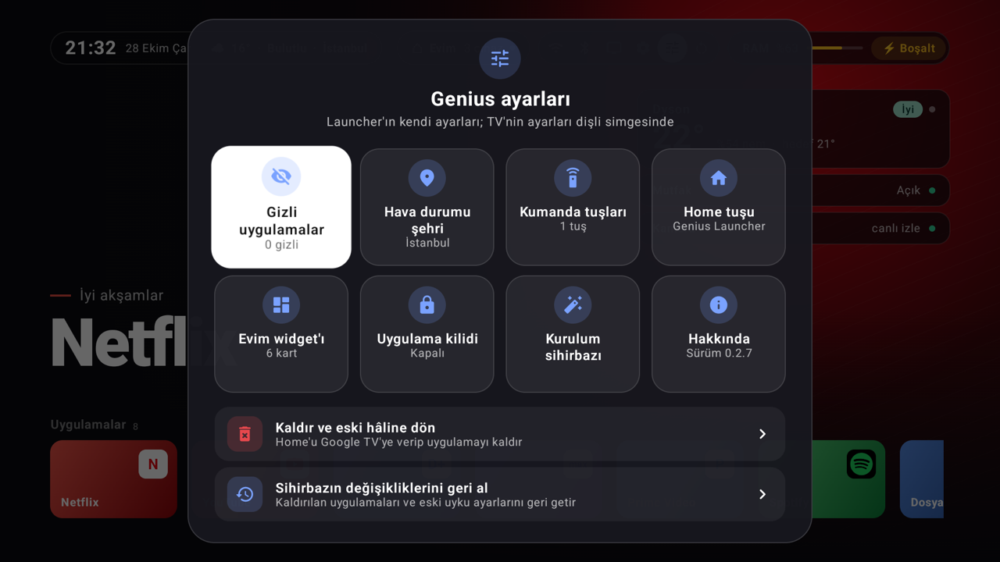
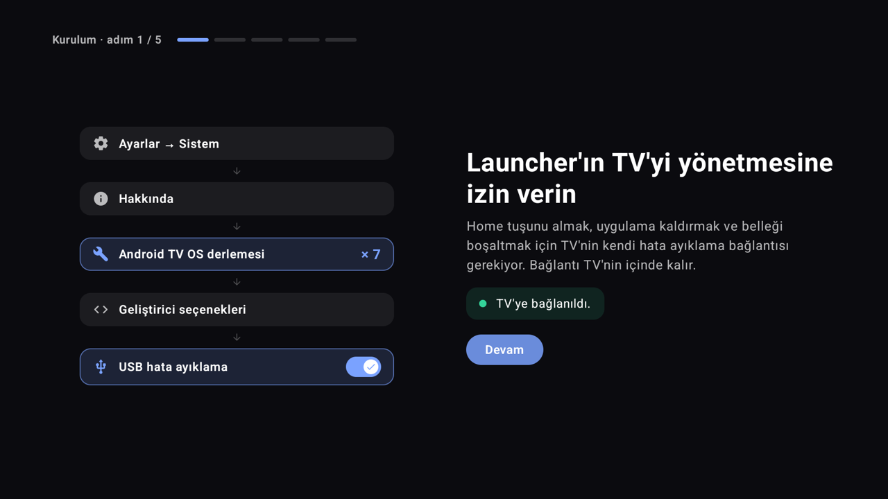

# Genius Launcher

**Türkçe** | [English](README.en.md)

Android TV ve Google TV için reklamsız, sade bir ana ekran. Evdeki akıllı cihazları da buluta gitmeden, ev ağından yönetir.



> Denenen cihazlar: Xiaomi Mi Box S 2. nesil (Google TV, Android 14) ve Mi Box S 1. nesil (Android TV, Android 9). Diğer Android TV cihazlarında da çalışması beklenir, ama denenmedi.

## Özellikler

- **Vitrin**: Odaktaki uygulamanın adı büyük harflerle yazılır; arka plan uygulamanın simgesinden çıkarılan renge boyanır.
- **Uygulamalar**: Kumandada OK'e basılı tutunca açılan menüden kartlar taşınır, gizlenir ya da rengi değiştirilir. Yeni kurulan uygulamaların kartı kendiliğinden gelir; gizlenenler Genius ayarlarından geri getirilir.
- **Dosyalar**: Dahili hafıza ve USB bellekteki dosyalar gezilir, yeniden adlandırılır ve silinir. Video, müzik ve resimler launcher'ın içinde açılır (TV'de oynatıcı uygulaması olmasa da). APK'lar onay sorulduktan sonra kurulur. **Telefondan dosya al** bir QR kod gösterir: telefonun kamerasıyla okutup açılan sayfadan dosya seçilir, dosyalar uygulama kurmadan ev ağından İndirilenler klasörüne gelir. Dosyalar da uygulamalar gibi bir karttır, istenirse gizlenir.
- **Uygulama kilidi**: Kartın menüsünden **Kilitle** seçilen uygulamalar 4 haneli PIN ile açılır; PIN Genius ayarlarından belirlenir ve ayarları da korur. PIN kumandanın yön tuşlarıyla ekrandaki tuş takımından girilir. PIN'in kendisi saklanmaz, yalnızca tuzlu özeti TV'de durur.
- **Hava durumu**: Saatin yanında anlık hava durumu; basınca saatlik ve 7 günlük tahmin açılır. Veriler [Open-Meteo](https://open-meteo.com)'dan gelir, şehir seçilebilir.
- **Akıllı ev**: Tuya (priz, röle, mama kabı), Dyson hava temizleyiciler ve Eufy kameralar sağ üstteki kartlarda görünür. Kartlar sıralanır ve yeniden adlandırılır; kaç kartın görüneceği seçilir (3–6), fazlası "Diğer" panelinde.
- **Kamera**: Eufy kameranın karta basınca tam ekran, sesli canlı görüntüsü (RTSP). Pan & Tilt kameralar kumandanın yön tuşlarıyla döndürülür.
- **Kurulum sihirbazı**: Tam ekran, görselli adımlarla TV'nin ADB izni, Home tuşu, gereksiz uygulamaların temizliği ve "uyanık tut". Hepsi geri alınabilir.
- **Bellek**: Üst şeritte RAM kullanımı; **Boşalt** arka plandaki uygulamaları kapatır.
- **Güncelleme**: Uygulama Play Store'da olmadığı için yeni sürümleri GitHub'dan kendisi bulur; Genius ayarları simgesinde bir nokta çıkar. **Güncelle**'ye basınca APK indirilir, GitHub'ın verdiği SHA-256 özetiyle doğrulanır ve TV'nin ADB'siyle kurulur; ayarlar ve cihazlar yerinde kalır.
- **Ekran koruyucu**: Google TV'deki gibi ana ekranda Geri tuşuna art arda iki kez basınca başlar.
- Türkçe ve İngilizce; sistem dilini izler.







## Akıllı ev

Cihazlar üst şeritteki **Evim** kutusundan eklenir: **Evim → Cihaz ekle**.



- **Tuya · Smart Life**: Uygulamadaki kullanıcı kodunu yazın ve TV'de çıkan QR kodu Smart Life uygulamasıyla okutun; hesaptaki cihazlardan eklemek istediklerinizi seçin. TV cihazları ev ağında kendisi bulur, adresleri değişirse yeniden arar. Cihaz yeniden kurulursa paneldeki **Yeniden bağlan** anahtarını yeniler.
- **Dyson**: MyDyson hesabıyla (e-postaya gelen kod ve şifre) ya da hesap olmadan cihazın üstündeki Wi-Fi etiketinden. TV hava temizleyiciyi ev ağında mDNS ile bulur.
- **Eufy kamera**: Önce Eufy uygulamasında **Kamera Ayarları → Genel → Depolama → NAS (RTSP)**'yi açıp bir kullanıcı adı ve parola belirleyin. Sonra TV'de kullanıcı adı ve parolayı yazın; TV kamerayı ev ağında kendisi bulur, bulamazsa IP adresini sorar. Döndürme için hesap gerekmez.

## Güvenlik

- Cihazlarla konuşma **ev ağında** olur. Hesaplara yalnızca cihaz eklerken bir kez bağlanılır.
- Tuya, Dyson ve Eufy **hesap şifreleri ve bulut jetonları saklanmaz**; yalnızca giriş sırasında kullanılır.
- Cihaz anahtarları (Tuya `local_key`, Dyson MQTT şifresi, Eufy RTSP parolası) yalnızca TV'de, uygulamanın özel depolamasında durur.
- **ADB bağlantısı TV'nin içinde kalır** (127.0.0.1). Launcher, normal bir uygulamanın Android 14'te yapamadığı işler için (Home tuşu, uygulama kaldırma, bellek boşaltma, dosya erişimi, APK kurma) TV'nin kendi ADB'sine bağlanır. İzin ilk seferde TV'de sorulur.
- Kamera görüntüsü buluta gitmez; ev ağından RTSP ile gelir.
- Bu repoda hiçbir cihaz anahtarı, hesap bilgisi ya da IP adresi bulunmaz. `secrets/`, `devices.json`, `*.secrets.json` ve `local.properties` `.gitignore` içindedir.

## Gereksinimler

- Android TV ya da Google TV, Android 8.0 veya üzeri
- Home tuşu, uygulama temizliği, bellek boşaltma ve Dosyalar için TV'de **USB hata ayıklama** (kurulum sihirbazı nasıl açılacağını gösterir)

## Kurulum

### Hazır sürüm

1. [Releases](https://github.com/meteciftci/genius-launcher/releases) sayfasından son sürümü indirin. İki sürüm var:
   - `genius-launcher-x.y.z.apk`: tam sürüm, akıllı ev dahil
   - `genius-launcher-lite-x.y.z.apk`: **Lite**, akıllı ev olmadan; ana ekran, Dosyalar, hava durumu ve güncellemeler aynı

   İkisi aynı uygulamadır, biri diğerinin üzerine kurulabilir; ayarlar korunur. Uygulama içi güncelleme kurulu sürümün türünü indirir.
2. Bilgisayardan TV'ye kurun (TV'de USB hata ayıklama açık olmalı):
   ```bash
   adb connect 192.168.1.50:5555
   adb install genius-launcher-x.y.z.apk
   ```
3. Uygulamalar listesinden **Genius Launcher**'ı açın. İlk açılışta kurulum sihirbazı çıkar.

### Kaynak koddan derleme

JDK 17 ve Android SDK (platform 35, build-tools 35) gerekir.

```bash
brew install openjdk@17
brew install --cask android-commandlinetools android-platform-tools
sdkmanager "platforms;android-35" "build-tools;35.0.0"
git clone https://github.com/meteciftci/genius-launcher.git
cd genius-launcher
```

`local.properties` dosyasına SDK yolunu yazın (bu dosya repoya girmez):

```
sdk.dir=/opt/homebrew/share/android-commandlinetools
```

Tuya cihazlarını TV'den eklemek için QR girişinin istemci kimliğini de aynı dosyaya yazın. Home Assistant'ın Tuya entegrasyonunun herkese açık kimliği kullanılabilir; yazılmazsa panelde Tuya seçeneği çalışmaz:

```
tuya.clientId=HA_3y9q4ak7g4ephrvke
tuya.schema=haauthorize
```

TV'nin adb adresini `tools/.tv` dosyasına yazın (bu dosya da repoya girmez):

```bash
echo 192.168.1.50:5555 > tools/.tv
```

Release derleyip TV'ye yükleyin. Betik uygulamayı cihazda önceden derler (ilk açılışlardaki takılmayı önler) ve açar. Lite sürüm için `lite` yazın:

```bash
zsh tools/install.sh
zsh tools/install.sh lite
```

Akıcılığı ölçmek için `zsh tools/perf.sh`. Mi Box temizliği ve uyku ayarları için yardımcı betikler `tools/mibox/` altında.

#### Örnek veriler

Launcher'a `demo` isteği gönderilirse TV'deki uygulamalar yerine örnek kartlar (Netflix, Disney+, HBO Max, Prime Video; gerçek logolar yerine harfler) ve şehir olarak İstanbul gösterilir. README ekran görüntüleri bu şekilde alınmıştır. Hiçbir ayar yazılmaz; launcher kapanınca örnek veriler kaybolur.

```bash
adb shell am start -n dev.evim.tv/.MainActivity --ez demo true
adb shell cmd locale set-app-locales dev.evim.tv --locales en-US   # İngilizce görüntüler için
```

## Kullanım

| Kumanda | İşlem |
| --- | --- |
| OK | Uygulamayı, cihazı ya da dosyayı aç |
| OK'e basılı tut | Menü: taşı, gizle, renk seç, yeniden adlandır, sil |
| Geri | Paneli kapat; Dosyalar'da bir üst klasöre çık |
| Ana ekranda Geri iki kez | Ekran koruyucuyu başlat |
| Kamerada yön tuşları | Pan & Tilt kamerayı döndür |
| Kamerada OK | Sesi aç/kapat |
| Müzikte OK / sol-sağ | Duraklat / 10 saniye sar |
| Resimde sol-sağ | Klasördeki önceki/sonraki resim |



### İlk kurulum sihirbazı



Launcher ilk açıldığında bir sihirbaz çıkar; her adım atlanabilir ve Genius ayarlarından yeniden çalıştırılabilir:

1. **TV'nin kendi ADB'si**: USB hata ayıklamanın nasıl açılacağını anlatır ve TV'nin izin penceresini çıkarır.
2. **Home tuşu**: Genius Launcher'ı ana ekran yapar (aşağıya bakın).
3. **Temizlik**: Markaya göre bilinen gereksiz uygulamaları listeler (önce Xiaomi Mi Box); önerilenler seçili gelir. Uygulamalar silinmez, kullanıcı için kaldırılır. Bağlı olunan Wi-Fi ağını kaydetmiş bir uygulama seçilemez.
4. **Uyanık tut (isteğe bağlı)**: TV kapanınca kutu uyumaz, ev ağında kalır.

Sihirbaz neyi değiştirdiğini (ayarların eski değerleriyle) kaydeder. Genius ayarlarındaki **Sihirbazın değişikliklerini geri al** yalnızca bunları eski hâline getirir; **Kaldır** da önce bunları geri getirmeyi sorar.

### Ana ekran (Home tuşu)

Google TV, kendi ana ekranı açıkken başka launcher'ları yok sayar; eski Android TV ana ekranı da öyle. Bu yüzden önce kurulum sihirbazı, sonra sistemin ana ekranı kapatılır (kaldırılmaz) ve Home tuşu Genius Launcher'a bağlanır. Bağlı olunan Wi-Fi ağını kaydeden uygulama kapatılacaksa hiçbir şey yapılmaz. Bunu kurulum sihirbazı ya da Genius ayarları yapar; geliştirme için aynısı bilgisayardan:

```bash
zsh tools/mibox/ana_ekran.sh genius   # Genius Launcher
zsh tools/mibox/ana_ekran.sh google   # Google TV'ye geri dön
```

Launcher 5 dakikada 3 kez çökerse Google TV ana ekranını kendiliğinden geri açar.

## Bilinen kısıtlar

- **Tuya**: Yerel protokolün 3.3 ve 3.4 sürümleri desteklenir, 3.5 henüz desteklenmez. Tam kontrol yalnızca denenmiş tiplerde var (priz/röle, Xenon X8605 mama kabı); bilinmeyen cihazlarda aç/kapa ya da yalnızca durum gösterilir.
- **Dyson**: Isıtmalı hava temizleyici (527K) ile denendi; diğer modellerde bazı değerler eksik görünebilir.
- **Eufy**: Yalnızca RTSP veren kameralar. Döndürme Indoor Cam Pan & Tilt (T8410) ile denendi. RTSP açıkken Eufy görüntüyü 1080p'ye düşürür.
- **Uygulama kilidi**: Yalnızca Genius'taki kartları korur; kilitli uygulama sesli komutla, başka bir uygulamadan ya da TV ayarlarından yine açılabilir. Çocukların kumandayla rastgele açmasını önlemek içindir. PIN unutulursa bilgisayardan `adb shell pm clear dev.evim.tv` ile Genius'un verileri silinir; PIN'le birlikte ayarlar ve akıllı ev cihazları da gider.
- **Dosyalar**: Video ve müzik, cihazın donanımının çözebildiği biçimlerde oynar. Launcher'ın kendi APK'sı Dosyalar'dan kurulunca launcher yeniden başlar.

## Teşekkür

- Google TV'de ana ekranı değiştirme yaklaşımı için [Free My TV](https://github.com/simbasjungles/free-my-tv) (MIT) projesinden ilham alındı.
- Tuya QR girişi [tuya-device-sharing-sdk](https://github.com/tuya/tuya-device-sharing-sdk)'nın (MIT), Dyson bulut girişi [libdyson-neon](https://github.com/libdyson-wg/libdyson-neon)'un (Apache-2.0) Kotlin'e taşınmış hâlidir.
- Eufy P2P yerel arama ve döndürme komutu [eufy-security-client](https://github.com/bropat/eufy-security-client)'tan (MIT) alındı.
- Kullanılan kütüphaneler: [dadb](https://github.com/mobile-dev-inc/dadb), [ZXing](https://github.com/zxing/zxing), [Media3](https://github.com/androidx/media) (hepsi Apache-2.0).

## Lisans

[MIT](LICENSE)
